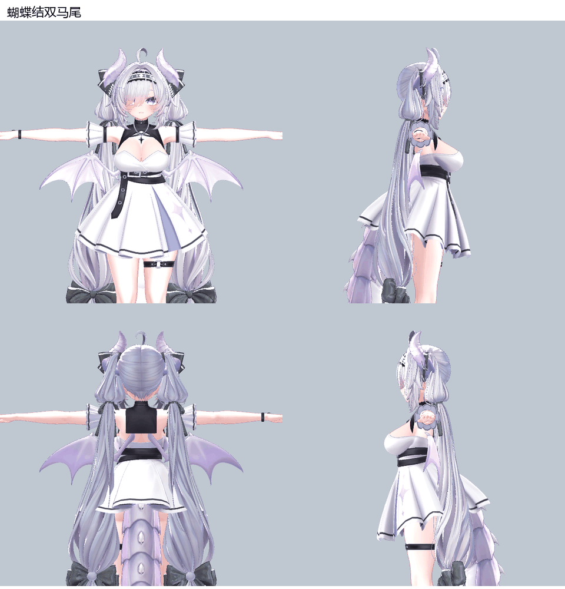

# Rainbow Hair Flow · 彩虹发丝流光

为 VRChat 头像选几束头发，让彩虹光带从发根沿着发梢移动。在 Unity 场景里预览，再调整发束分布、方向和光带宽度。

## 安装与使用

1. 从项目的 **Releases** 下载并导入 `RainbowHairFlow-0.3.0.unitypackage`。
2. 打开 **Tools → 彩虹发丝流光 → 打开工具**，选择头像的头发 Renderer 和源材质槽。
3. 点击 **分析发束**，使用左右均衡随机选择，再逐束校正。打开预览，调整宽度、亮度与速度。
4. 确认流向后生成效果。需要在游戏里切换流光时，先安装 VRChat Avatars SDK 和 Modular Avatar。

适用于 Unity 2022.3、Built-in 渲染管线和 Windows 头像。每次处理一个 Renderer 的一个材质槽。已使用双马尾、侧丸子盘发和长发验证。具体操作、透明材质适配与卸载方法见[使用教程和常见问题](Assets/RainbowHairFlow/README.md)。

## 反馈问题

插件窗口右上角的 **反馈 Bug** 会在浏览器打开 GitHub Issues，填入插件版本、Unity 版本和目标平台。补充复现步骤和截图后，由你确认提交。

## 发布维护

将本目录作为仓库根目录，开启 Issues。推送标签 `v0.3.0` 后，在 Actions 的 Package 任务下载构建产物，将其中的 unitypackage 附到 Release。构建时会将反馈入口绑定到实际仓库。本地可运行 `python tools/package.py Avenir-L/RainbowHairFlow` 生成安装包。
